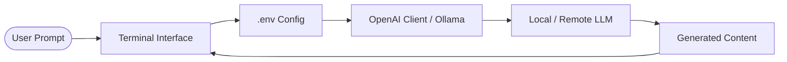

# Chapter 01: Foundations of Agentic AI & First Model Interaction


**Phase:** Phase 1: Foundations & Context | **Project:** Akshvani (AI-AGENT-AKSHVANI)

---

## 🎯 Chapter Objective & Executive Summary
Setting up the local AI environment, connecting to Ollama/OpenAI-compatible LLM endpoints, and constructing a stateless conversational loop for Akshvani.

This chapter represents an integral milestone in our progressive 21-chapter engineering journey to build Akshvani from first principles. Each chapter systematically builds upon the architectural foundations and capabilities established in earlier chapters.

---

## 🧠 Core Engineering Concepts & Theory
- LLM API client initialization using OpenAI SDK standards
- Environment configuration isolation via `.env`
- Prompt-completion lifecycle and token response parsing
- Interactive continuous conversational loop in the terminal
- Handling user termination commands ('quit')

---

## 🗺️ Architectural Flow


---

## 📑 Progressive Implementation Breakdown
### Part 1: Basic Model Completion (`hello-ai.py`)
Establishing connection to the inference server and sending a single one-shot completion request to verify API connectivity and model responsiveness.

### Part 2: Interactive Chat Assistant (`ai-assistant.py`)
Building the continuous CLI loop for 'Akshvani', accepting dynamic user prompts and streaming back AI responses.

---

## 🛠️ Key Classes, Signatures & Schemas
- `OpenAI(base_url, api_key)`: Standard unified client interface for local/remote LLMs
- `load_dotenv()`: Safe environment variable management (`BASE_URL`, `API_KEY`, `MODEL`)
- `client.chat.completions.create(...)`: Chat completions request invocation
- `while True` loop: Real-time interactive user engagement loop

---

## 📁 Expected Directory Structure & Deliverables
```text
CHAPTER-01/
├── README.md              # Chapter documentation (this file)
├── hello-ai.py            # Initial one-shot connectivity test script
├── ai-assistant.py        # Interactive CLI assistant named Akshvani
├── .env                   # Local environment configuration holding model endpoint details
```

---

## 🧪 Verification & Acceptance Criteria
To validate that this chapter's implementation meets all functional criteria:
- [ ] Verify `.env` has valid `BASE_URL`, `API_KEY`, and `MODEL` parameters
- [ ] Run `python hello-ai.py` and confirm successful model response
- [ ] Run `python ai-assistant.py` and engage in multi-turn conversation
- [ ] Type `quit` to confirm graceful exit

---

## 🔮 What's Next?
Chapter 02 introduces multi-turn conversation memory, retaining contextual history across conversational turns.
