# 🤖 Akshvani (आकाशवाणी) — Autonomous AI Agent Engineering
### *A 21-Chapter Engineering Journey from First Principles to a Full-Stack Autonomous Enterprise Agent*

[](#-21-chapter-master-roadmap--phases)
[](#-current-status-chapter-01-completed)
[](https://www.python.org/)
[-orange)](https://modelcontextprotocol.io/)
[](https://langchain-ai.github.io/langgraph/)
[](https://fastapi.tiangolo.com/)

---

## 🌟 Vision & Overview
**Akshvani** (*आकाशवाणी* — "Celestial Voice") is a comprehensive, production-grade autonomous AI agent engineered systematically across **21 progressive chapters**. 

This repository documents every single layer of agentic autonomy built **from first principles**, intentionally avoiding fragile black-box abstractions:
1. **Foundations & Context**: From raw model completions to stateful conversation history and role steering.
2. **Deterministic Grounding**: Native Python tool dispatchers and secure file system I/O grounding.
3. **Retrieval-Augmented Generation (RAG)**: Pure-math cosine similarity and vector search from scratch, scaling to production ChromaDB with cross-encoder rerankers.
4. **Protocols & ReAct State Machines**: The open Model Context Protocol (FastMCP), formal state machines, and iterative ReAct loops.
5. **Hierarchical Planning & Persistent Memory**: Multi-step task decomposition and SQLite persistent semantic memory stores.
6. **Multi-Agent Systems & Governance**: Collaborative manager-worker teams, RBAC tool permissions, input validation guardrails, and audit logging.
7. **Production Frameworks & Deep Research**: LangGraph state graphs with Human-in-the-Loop (HITL) breakpoints, CrewAI squads, and autonomous web research engines.
8. **Enterprise Delivery**: Scalable FastAPI REST API with rate limiting, automated evaluation benchmarking suites, and a full-stack responsive web UI.

---

## 🚀 Architectural Evolution & Phases

```mermaid
flowchart TD
    subgraph Phase1 [Phase 1: Foundations & Context]
        C1[Chapter 01: First Model Call & Interactive Loop]
        C2[Chapter 02: Multi-Turn Memory Management]
        C3[Chapter 03: System Prompts & Personas]
    end

    subgraph Phase2 [Phase 2: Deterministic Grounding & Tools]
        C4[Chapter 04: Deterministic Tools & Dispatcher]
        C5[Chapter 05: File System I/O Grounding]
        C6[Chapter 06: RAG & Vector Math from Scratch]
    end

    subgraph Phase3 [Phase 3: Protocols & ReAct State Machines]
        C7[Chapter 07: Intent Planning & Tool Selection]
        C8[Chapter 08: Model Context Protocol MCP Standard]
        C9[Chapter 09: Stateful Agent Architecture & ReAct Loop]
    end

    subgraph Phase4 [Phase 4: Advanced Reasoning & Memory]
        C10[Chapter 10: Hierarchical Task Decomposition]
        C11[Chapter 11: Persistent Semantic SQLite Memory]
        C12[Chapter 12: Production RAG with ChromaDB & Reranking]
    end

    subgraph Phase5 [Phase 5: Multi-System Orchestration & Governance]
        C13[Chapter 13: Distributed Multi-MCP Server Registry]
        C14[Chapter 14: Multi-Agent Collaboration: Manager-Workers]
        C15[Chapter 15: Enterprise Governance, RBAC & Telemetry]
    end

    subgraph Phase6 [Phase 6: Advanced Frameworks & Deep Research]
        C16[Chapter 16: Graph Workflows with LangGraph & HITL]
        C17[Chapter 17: Enterprise Crews with CrewAI & MCP]
        C18[Chapter 18: Autonomous Web Research & Fact Verification]
    end

    subgraph Phase7 [Phase 7: Production Full-Stack Deployment]
        C19[Chapter 19: Unified Enterprise Agent Architecture]
        C20[Chapter 20: Production REST API & Automated Eval Suite]
        C21[Chapter 21: Full-Stack Web Application for Akshvani]
    end

    Phase1 --> Phase2 --> Phase3 --> Phase4 --> Phase5 --> Phase6 --> Phase7
```



---

## 📊 21-Chapter Master Roadmap & Phases

| Chapter | Title | Phase / Focus | Milestone / Artifact | Status |
| :---: | :--- | :--- | :--- | :---: |
| [**01**](./CHAPTER-01/README.md) | **Foundations of Agentic AI** | Phase 1: Foundations & Context | `hello-ai.py`, `ai-assistant.py` | ✅ **Completed** |
| [**02**](./CHAPTER-02/README.md) | **Multi-Turn Context Memory** | Phase 1: Foundations & Context | Context-aware dialogue loop | ⏳ Planned |
| [**03**](./CHAPTER-03/README.md) | **System Prompts & Personas** | Phase 1: Foundations & Context | Dynamic persona selector | ⏳ Planned |
| [**04**](./CHAPTER-04/README.md) | **Deterministic Tools from Scratch** | Phase 2: Deterministic Grounding | Native Python tool dispatcher | ⏳ Planned |
| [**05**](./CHAPTER-05/README.md) | **File System Grounding** | Phase 2: Deterministic Grounding | Grounded file I/O agent | ⏳ Planned |
| [**06**](./CHAPTER-06/README.md) | **Semantic Search & RAG from Scratch** | Phase 2: Deterministic Grounding | Pure-math RAG pipeline | ⏳ Planned |
| [**07**](./CHAPTER-07/README.md) | **Intent Planning & Tool Selection** | Phase 3: Protocols & State Machines | Dynamic intent router | ⏳ Planned |
| [**08**](./CHAPTER-08/README.md) | **Model Context Protocol (MCP)** | Phase 3: Protocols & State Machines | Standardized MCP agent | ⏳ Planned |
| [**09**](./CHAPTER-09/README.md) | **ReAct Agent Loop & State Machine** | Phase 3: Protocols & State Machines | Autonomous ReAct engine | ⏳ Planned |
| [**10**](./CHAPTER-10/README.md) | **Hierarchical Task Planning** | Phase 4: Advanced Reasoning & Memory | Task planner & synthesizer | ⏳ Planned |
| [**11**](./CHAPTER-11/README.md) | **Persistent Semantic Memory** | Phase 4: Advanced Reasoning & Memory | Cross-session memory agent | ⏳ Planned |
| [**12**](./CHAPTER-12/README.md) | **Production-Grade Advanced RAG** | Phase 4: Advanced Reasoning & Memory | Reranked RAG engine | ⏳ Planned |
| [**13**](./CHAPTER-13/README.md) | **Multi-MCP Server Registry** | Phase 5: Multi-System Orchestration | Multi-MCP server manager | ⏳ Planned |
| [**14**](./CHAPTER-14/README.md) | **Multi-Agent Collaboration** | Phase 5: Multi-System Orchestration | Collaborative agent team | ⏳ Planned |
| [**15**](./CHAPTER-15/README.md) | **Enterprise Governance & Security** | Phase 5: Multi-System Orchestration | Hardened enterprise agent | ⏳ Planned |
| [**16**](./CHAPTER-16/README.md) | **LangGraph Workflows & HITL** | Phase 6: Advanced Frameworks | Human-in-the-Loop workflows | ⏳ Planned |
| [**17**](./CHAPTER-17/README.md) | **CrewAI Enterprise Orchestration** | Phase 6: Advanced Frameworks | Enterprise CrewAI squad | ⏳ Planned |
| [**18**](./CHAPTER-18/README.md) | **Autonomous Deep Research Agent** | Phase 6: Advanced Frameworks | Automated research reporter | ⏳ Planned |
| [**19**](./CHAPTER-19/README.md) | **Unified Enterprise Architecture** | Phase 7: Production Full-Stack | Unified enterprise runtime | ⏳ Planned |
| [**20**](./CHAPTER-20/README.md) | **Production REST API & Evaluation** | Phase 7: Production Full-Stack | REST API & eval suite | ⏳ Planned |
| [**21**](./CHAPTER-21/README.md) | **Full-Stack Agent Web Application** | Phase 7: Production Full-Stack | Complete Full-Stack Akshvani | ⏳ Planned |

---

## 📍 Current Status: Chapter 01 Completed!

The initial milestone is live: **Chapter 01: Foundations of Agentic AI & First Model Interaction**!

### What Was Built in Chapter 01:
1. **Connectivity Layer (`CHAPTER-01/hello-ai.py`)**:
   - Initialized the standard OpenAI client configured against local Ollama / OpenAI-compatible endpoint.
   - Tested zero-shot inference for `"What is Artificial Intelligence?"`.
2. **Interactive Terminal Assistant (`CHAPTER-01/ai-assistant.py`)**:
   - Implemented the continuous CLI chat loop for **Akshvani**.
   - Added user input interception, response generation, and graceful `quit` handling.
3. **Configuration Isolation (`CHAPTER-01/.env`)**:
   - Secured endpoint credentials: `BASE_URL`, `API_KEY`, and `MODEL`.

### Running Chapter 01:
```bash
# 1. Activate virtual environment
source .venv/bin/activate

# 2. Navigate to Chapter 01
cd CHAPTER-01

# 3. Ensure your local LLM (Ollama or API endpoint) is configured in .env

# 4. Run the connectivity check
python hello-ai.py

# 5. Start the interactive Akshvani CLI
python ai-assistant.py
```

---

## 🛠️ Technology Stack & Ecosystem

- **Language & Runtime**: Python 3.10+
- **Inference Protocols**: OpenAI Python SDK, Ollama API
- **Protocols & Tooling**: Model Context Protocol (FastMCP), stdio JSON-RPC
- **Vector Storage & Retrieval**: In-Memory Vector Mathematics, ChromaDB
- **Orchestration & State**: LangGraph, CrewAI, Custom ReAct State Machines
- **Web Scraping & Research**: BeautifulSoup4, Requests
- **Backend & API**: FastAPI, Uvicorn, Pydantic
- **Frontend**: Responsive HTML5, CSS3, Vanilla JavaScript (Zero framework bloat)
- **Data Persistence**: SQLite3, ChromaDB, File System

---

## ⚙️ Environment Configuration

All chapters utilize a unified environment configuration strategy via `.env`. A baseline template:

```env
# LLM Endpoint Configuration (Ollama / Local LLM / Remote OpenAI)
BASE_URL=http://localhost:11434/v1
API_KEY=ollama
MODEL=llama3.2

# Embedding Model Configuration
EMBEDDING_MODEL=nomic-embed-text

# Optional API Keys for Advanced Chapters
TAVILY_API_KEY=your_key_here
```

---

## 🏛️ Engineering Philosophy & Rules of Engagement

1. **First Principles First**: We build memory, tools, RAG, and state loops from pure Python before adopting high-level libraries.
2. **Deterministic Safety**: Tools must have strict input validation, exception boundaries, and audit logging.
3. **Decoupled Architecture**: State, planning, tool execution, and response synthesis remain separate modules.
4. **Standard Protocols Over Custom Wrappers**: We adhere to the Model Context Protocol (MCP) for tool interoperability.
5. **Continuous Verification**: Every chapter includes unit tests and acceptance criteria.
